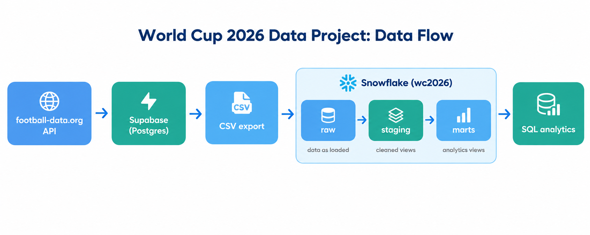

# World Cup 2026 Data Project

A small data engineering and analytics practice project, built by reusing the match data from my [World Cup 2026 Tracker](https://github.com/mareerray/worldcup2026-tracker) app.

**Status:** In progress. The raw layer is loaded and checked. Staging and marts views are next.

## Why I built this

I'm learning data engineering and analytics engineering. I wanted to practice data modeling, SQL and analytics on real data, so I reused the data from my own app instead of a sample dataset.

## Data flow



```
football-data.org API → Supabase (Postgres) → CSV export → Snowflake → SQL views
```

1. **API:** My World Cup tracker app gets match data from the football-data.org API.
2. **Supabase:** The data is stored in a Supabase Postgres database.
3. **CSV export:** I export the tables from Supabase as CSV files.
4. **Snowflake:** I load the CSV files into Snowflake (free trial) using the Snowsight Load Data wizard.
5. **SQL views:** I build cleaning and analytics views on top of the loaded data.

## Data layers

| Schema | Layer | What goes there | Status |
|--------|-------|-----------------|--------|
| `raw` | Raw | Data loaded as exported, with no changes | Done |
| `staging` | Cleaned | Cleaning views such as `match_analytics` | Next |
| `marts` | Analytics | Final views such as `team_performance` | Planned |

## Raw tables

| Table | Rows | Description |
|-------|------|-------------|
| `teams` | 48 | One row per national team |
| `matches` | 104 | One row per match, with score, stage and date |
| `scorers` | 100 | One row per player, with goal totals |
| `standings` | 48 | One overall ranking row per team |

Dates are loaded as they came from Supabase. Converting them to proper timestamps is a job for the staging layer.

## Data quality checks

`sql/03_checks.sql` runs after each load. It checks that:

- Row counts match what I expect.
- No ID appears twice. Snowflake does not enforce primary keys, so I test this myself.
- Every team ID in `matches`, `scorers` and `standings` exists in `teams`. Snowflake does not enforce foreign keys either.

## Questions I want to answer

- Which teams scored the most goals?
- How many matches ended in a draw?
- Do home teams win more often than away teams?

## Project structure
```
wc2026-data-project/
├── README.md
├── .gitignore
├── docs/
│   └── data-flow.png
└── sql/
    ├── 01_setup.sql
    ├── 02_raw_tables.sql
    └── 03_checks.sql
```


## How to reproduce

1. Create a Snowflake trial account.
2. Run `sql/01_setup.sql` to create the warehouse, the database and the three schemas.
3. Run `sql/02_raw_tables.sql` to create the raw tables.
4. Export `teams`, `matches`, `scorers` and `standings` from Supabase as CSV files.
5. Load each CSV into its table in the `raw` schema.
6. Run `sql/03_checks.sql` and confirm that every check passes.

The CSV files are not stored in this repo.

## Tools

- Snowflake (SQL)
- Supabase (PostgreSQL)
- football-data.org API

## What's next

- [x] Set up Snowflake and the three data layers
- [x] Load the raw tables and check them
- [ ] Build staging views (`match_analytics`, `match_details`)
- [ ] Build marts views (`team_performance`, `stage_analytics`)
- [ ] Add a data model diagram and a results screenshot
- [ ] Add dbt models on top of the Snowflake tables

## Notes

The original app and its Postgres schema were built with help from AI. For this project I use AI as a tutor to explain concepts and review my work. I run and check every query myself, and I write up what I learn here.

No passwords or API keys are stored in this repo.
